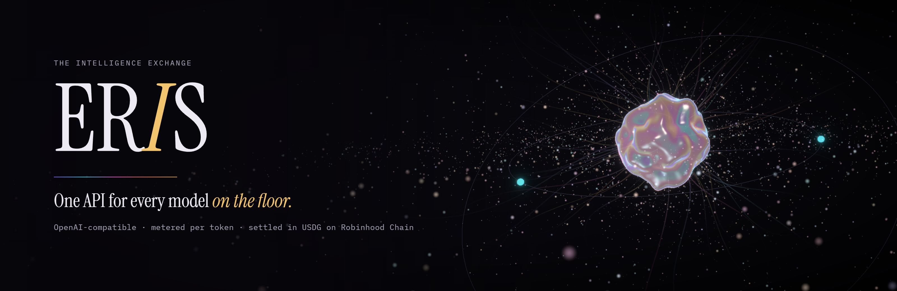
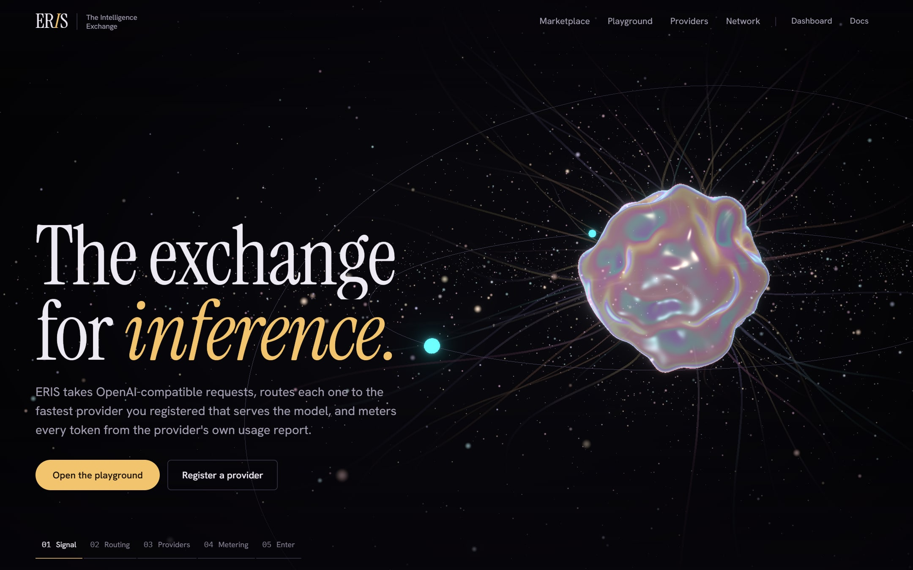
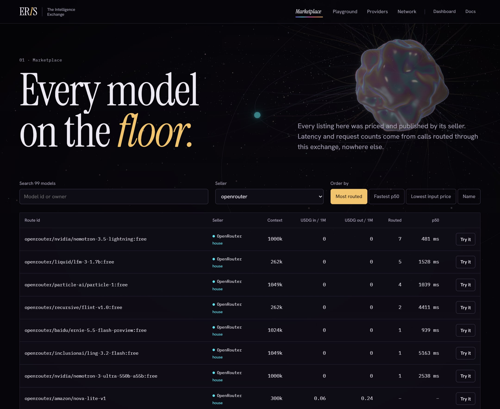
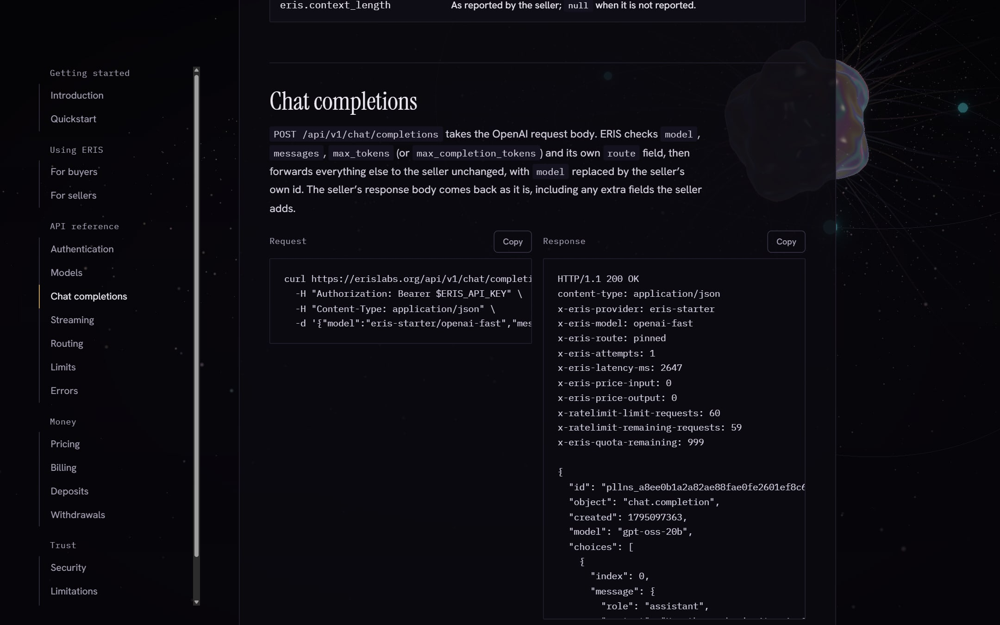
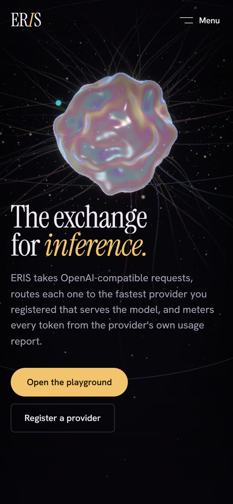
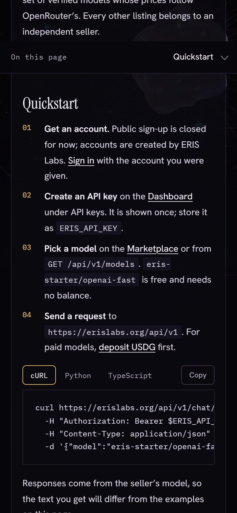
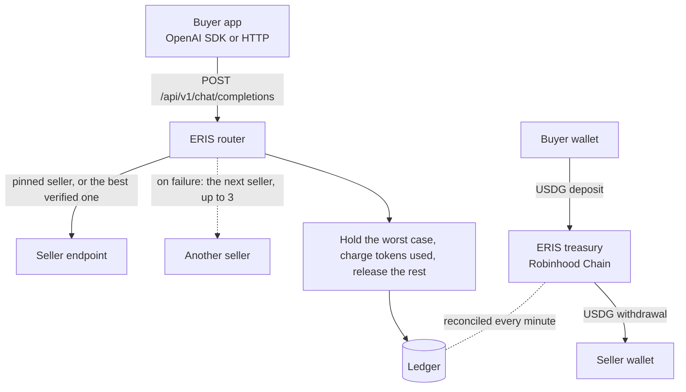

<p align="center">
  <a href="https://erislabs.org"></a>
</p>

<p align="center">
  <a href="https://erislabs.org"></a>
  <a href="docs/billing.md#the-payment-token"></a>
  <a href="docs/billing.md"></a>
  <a href="docs/api.md"></a>
  <a href="https://erislabs.org/docs"></a>
  <a href="https://github.com/ErisEngine/eris/actions/workflows/examples.yml"></a>
  <a href="LICENSE"></a>
</p>

<p align="center">
  <b>ERIS is an exchange for AI inference.</b><br>
  Sellers list OpenAI-compatible endpoints at their own prices. Buyers call one API.<br>
  Each request is routed to a listed seller, metered by the tokens it used, and settled in USDG.
</p>

<p align="center">
  <a href="https://erislabs.org">Website</a> ·
  <a href="https://erislabs.org/marketplace">Marketplace</a> ·
  <a href="docs/api.md">API reference</a> ·
  <a href="examples">Examples</a> ·
  <a href="docs/architecture.md">Architecture</a> ·
  <a href="https://erislabs.org/support">Support</a>
</p>


## What this repository is

The public home of ERIS's documentation and client examples. The exchange itself runs at **[erislabs.org](https://erislabs.org)** and is operated by ERIS Labs; its source code, infrastructure and treasury are not published here.

| Folder | Contents |
|---|---|
| **[`docs/`](docs)** | How ERIS works: the API, routing, pricing and USDG billing, selling, the security model, architecture. |
| **[`examples/`](examples)** | Runnable cURL, Python and TypeScript clients, checked in CI. |
| **[`assets/`](assets)** | The banner and the product screenshots used here. |


## The product

<table>
  <tr>
    <td width="50%" valign="top"></td>
    <td width="50%" valign="top"></td>
  </tr>
  <tr>
    <td valign="top"><b>The exchange.</b> One live WebGL scene, the Chromatic Neural Core, runs behind every page. Each light that crosses it is a real, completed request.</td>
    <td valign="top"><b>The marketplace.</b> Every listing shows its seller, context, input and output price per million tokens, and the latency measured on calls routed through ERIS.</td>
  </tr>
  <tr>
    <td valign="top"></td>
    <td valign="top">
      <p align="center">
        
        
      </p>
    </td>
  </tr>
  <tr>
    <td valign="top"><b>Documentation.</b> The responses shown on <a href="https://erislabs.org/docs">erislabs.org/docs</a> are captured from real calls, headers included.</td>
    <td valign="top"><b>On a phone.</b> The same exchange and the same core, laid out for a small screen.</td>
  </tr>
</table>


## How it works



1. **Route.** `seller/model` pins one seller. A bare model id goes to every *verified* seller that lists it, ranked by price, latency or both, with up to three attempts. See [Routing](docs/routing.md).
2. **Hold.** Before any seller is contacted, ERIS holds the most the request could cost from the buyer's USDG balance. See [Billing](docs/billing.md).
3. **Settle.** The buyer is charged the serving seller's listed price for the tokens it reported; the rest of the hold returns at once. Failed requests cost nothing. Sellers receive 95%.
4. **Move money on chain.** Deposits arrive as USDG on Robinhood Chain from a wallet the buyer has proven they control; sellers withdraw to theirs. See [Deposits](docs/billing.md#deposits).

The full picture, with a request lifecycle and the settlement loop, is in **[docs/architecture.md](docs/architecture.md)**.


## Quickstart

> [!NOTE]
> Public sign-up is closed for now: accounts are created by ERIS Labs. With an account, create a key on the [Dashboard](https://erislabs.org/dashboard). `eris-starter/openai-fast` is free and needs no balance.

```bash
export ERIS_API_KEY=eris_sk_...

curl https://erislabs.org/api/v1/chat/completions \
  -H "Authorization: Bearer $ERIS_API_KEY" \
  -H "Content-Type: application/json" \
  -d '{"model":"eris-starter/openai-fast","messages":[{"role":"user","content":"Say hello in five words."}],"max_tokens":40}'
```

Any OpenAI SDK works: change the base URL and use your ERIS key.

**Python**

```python
import os
from openai import OpenAI

client = OpenAI(
    base_url="https://erislabs.org/api/v1",
    api_key=os.environ["ERIS_API_KEY"],
)
resp = client.chat.completions.create(
    model="eris-starter/openai-fast",
    messages=[{"role": "user", "content": "Say hello in five words."}],
    max_tokens=40,
)
print(resp.choices[0].message.content)
```

**TypeScript**

```ts
import OpenAI from "openai";

const client = new OpenAI({
  baseURL: "https://erislabs.org/api/v1",
  apiKey: process.env.ERIS_API_KEY,
});
const resp = await client.chat.completions.create({
  model: "eris-starter/openai-fast",
  messages: [{ role: "user", content: "Say hello in five words." }],
  max_tokens: 40,
});
console.log(resp.choices[0].message.content);
```

Streaming, routing modes and error handling are in **[`examples/`](examples)**.


## The API at a glance

| Interface | Purpose |
|---|---|
| `GET /api/v1/models` | Every model you can call now, in the OpenAI list format, with seller, context and price per million tokens. |
| `POST /api/v1/chat/completions` | The OpenAI chat completions body, streamed or not. Parameters pass through to the seller unchanged. |
| `route` · `x-eris-route` | `balanced` (default), `price` or `latency`, for a bare model id. |
| `Idempotency-Key` | A repeated paid request with the same key is refused instead of charged twice. |

Every response says what happened:

```http
x-eris-provider: eris-starter
x-eris-model: openai-fast
x-eris-route: pinned
x-eris-attempts: 1
x-eris-price-input: 0
x-eris-price-output: 0
x-ratelimit-remaining-requests: 59
x-eris-quota-remaining: 999
```

Errors use the OpenAI envelope, with a reference you can quote to support. The full reference: **[docs/api.md](docs/api.md)**.


## Built with

| Layer | Technology |
|---|---|
| Application | Next.js 15 · React 19 · TypeScript |
| Data | PostgreSQL: balances reconciled against a journal, request records |
| Chain | Robinhood Chain (4663) · USDG · viem |
| Interface | three.js and React Three Fiber (the Neural Core) · GSAP · Lenis |
| Hosting | Vercel, with a scheduler that runs settlement every minute |


## Current limitations

Stated plainly, so nothing here reads as a promise:

- Public sign-up is closed; accounts are created by ERIS Labs.
- The API covers chat completions and the model list. There are no embeddings, image or audio endpoints.
- A buying balance pays for requests and cannot be withdrawn from the dashboard. Only seller earnings can.
- Deposits are USDG on Robinhood Chain only, from the one wallet linked to an account.
- Whether parameters such as `tools` work depends on each seller's model; ERIS passes them through.
- Charges are estimated, and marked so, when a seller does not report token usage.


## Documentation

| Page | Covers |
|---|---|
| [API reference](docs/api.md) | Authentication, models, chat completions, streaming, headers, limits, errors. |
| [Routing](docs/routing.md) | Pinned and cross-seller routing, verified sellers, route modes, failover. |
| [Billing and USDG](docs/billing.md) | Prices, holds and charges, the payment token, deposits, withdrawals. |
| [Selling on ERIS](docs/sellers.md) | Registering an endpoint, pricing, health checks, earnings. |
| [Architecture](docs/architecture.md) | The system, a request's lifecycle, the settlement loop. |
| [Security model](docs/security-model.md) | Keys, accounts, prompts, sellers, money. |
| [FAQ](docs/faq.md) | Short answers to common questions. |

Also: [Changelog](CHANGELOG.md) · [Contributing](CONTRIBUTING.md) · [Security policy](SECURITY.md) · [Terms](https://erislabs.org/terms) · [Privacy](https://erislabs.org/privacy) · [Custody and risk](https://erislabs.org/disclosures)


<p align="center">
  <a href="https://erislabs.org"><b>erislabs.org</b></a><br>
  <sub>ERIS · The Intelligence Exchange · © 2026 ERIS Labs</sub><br>
  <sub><a href="https://x.com/eris_labs">X</a> · <a href="https://erislabs.org/support">Support</a> · <a href="https://erislabs.org/docs">Docs</a></sub>
</p>
