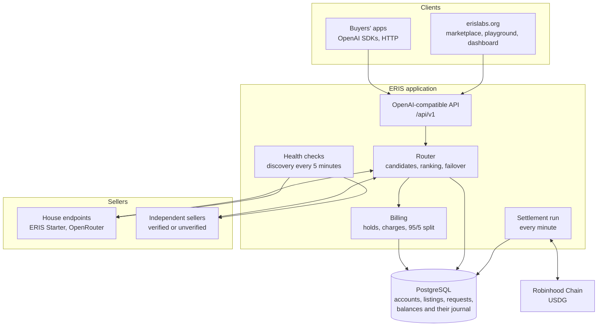
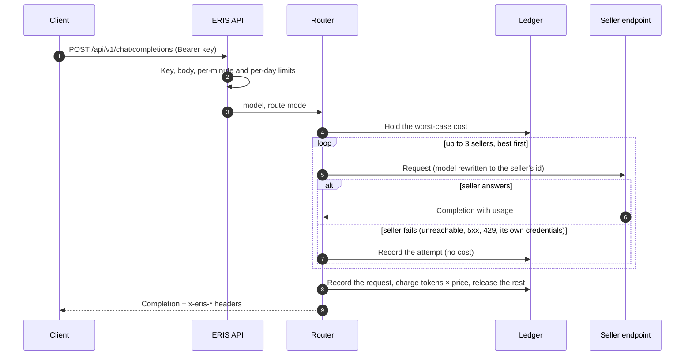
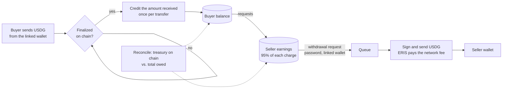

# Architecture

ERIS is one web application in front of a ledger and a chain. This page describes how its parts fit together, at the level a client developer or seller needs. The service's source code is not published.

## The system

| Part | What it does |
|---|---|
| API | Authenticates keys, validates the request, enforces per-key limits. |
| Router | Finds the listings that may serve a model, ranks them, tries up to three, records every attempt. See [Routing](routing.md). |
| Billing | Holds the worst-case cost, charges the tokens used, credits the seller 95% and the platform 5%. See [Billing](billing.md). |
| Health checks | Re-reads each seller's `/models` and marks endpoints and models online or offline. |
| Settlement run | Credits finalized USDG deposits from linked wallets, sends queued withdrawals, and reconciles the treasury's on-chain balance with what accounts are owed. |
| Ledger | Every balance change is a journal entry, and balances must always equal their journal. |

## A request's lifecycle

- Prompts and completions pass through; ERIS records metadata (time, model, seller, tokens, price, status), not content.
- A seller's own failure (its credentials, its credit, its rate limit) is never shown to the buyer as the buyer's error.
- After three failed calls or checks in a row, an endpoint is tried only after healthier sellers until it succeeds again.

## The settlement loop

## Interface

The site is a Next.js application. One WebGL scene, the Chromatic Neural Core (three.js through React Three Fiber), stays mounted across pages; routes move its camera instead of reloading it, and each completed request sends a light along one of its filaments. Motion uses GSAP and Lenis, waits for the first-visit intro, and is reduced to stillness when the system asks for reduced motion.
