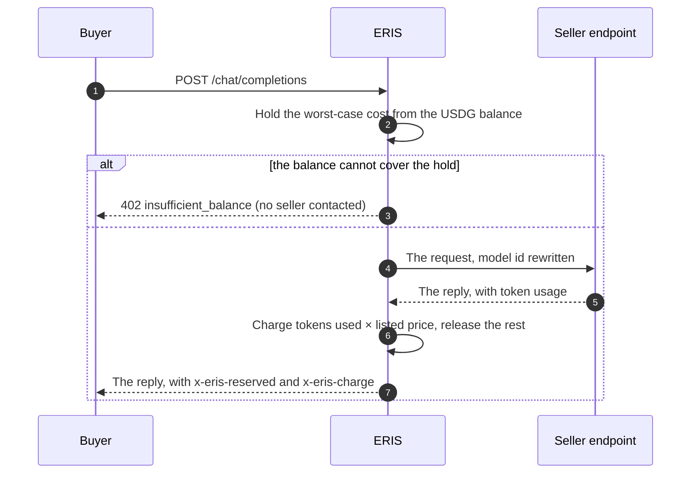

# Billing and USDG

What a request costs, how it is paid, and how money moves on chain.

**Contents:** [Pricing](#pricing) · [Holds and charges](#holds-and-charges) · [The payment token](#the-payment-token) · [Deposits](#deposits) · [Withdrawals](#withdrawals) · [Custody](#custody)

## Pricing

Every listing has two prices in US dollars per million tokens: input (prompt) and output (completion). They are paid in USDG at 1 USDG = $1.

```
charge = (prompt_tokens × input price + completion_tokens × output price) / 1,000,000
```

A request using 317 prompt tokens and 62 completion tokens on a listing priced $0.15 input and $0.60 output costs (317 × 0.15 + 62 × 0.60) / 1,000,000 = **0.00008475 USDG**. The seller receives 95% of it and ERIS keeps a 5% platform fee. The buyer always pays exactly the listed price; the fee comes out of the seller's share.

- Token counts are the ones the seller reports. Amounts are kept to 18 decimal places and rounded up, so a seller is never paid less than its price.
- The price is the one listed when the request runs. Sellers can change prices at any time; the house OpenRouter listings follow OpenRouter's prices.
- Listings priced at zero are free and need no balance.

## Holds and charges



1. **Hold.** Assumes the whole prompt is billable (its size in bytes, plus 1,024 tokens for a seller's own system prompt) and that the full `max_tokens` is generated, at the highest price among the sellers that may be tried. Without `max_tokens` on a paid request, ERIS sets it to 4,096 so the hold has a limit.
2. **Charge.** The tokens used at the serving seller's price, never more than the hold.
3. **Release.** The rest of the hold returns at once. A failed request is not charged.

Lower `max_tokens` to lower the hold. A charge marked *est.* means the seller did not report usage, so ERIS estimated it at about four characters per token.

## The payment token

| Property | Value |
|---|---|
| Token | USDG (Global Dollar), issued by Paxos, not by ERIS |
| Network | Robinhood Chain, chain ID 4663 |
| Contract | [`0x5fc5360d0400a0fd4f2af552add042d716f1d168`](https://robinhoodchain.blockscout.com/token/0x5fc5360D0400a0fD4f2aF552Add042d716f1d168) |
| Decimals on chain | 6 |

## Deposits

1. **Link a wallet** on the Dashboard by signing a one-time message in your browser wallet. Signing is free; it is not a transaction. An account has one linked wallet, and a wallet can be linked to one account.
2. **Send USDG on Robinhood Chain** from that wallet to the deposit address shown on your Dashboard.
3. **Wait for finality.** A deposit is credited once the network has finalized the transaction. ERIS finds deposits from linked wallets on its own; you can also paste the transaction hash to check it.

You are credited the amount the deposit address actually received, once per transfer. A deposit sent from a wallet you had not linked is credited after you link that wallet and check the transaction by its hash: ERIS never credits a deposit without proof that the account controls the sending wallet. Other tokens, other networks and other addresses cannot be credited.

## Withdrawals

Sellers withdraw earnings from the Dashboard to their linked wallet.

- Each withdrawal needs the account password and goes only to the linked wallet.
- The minimum is 1 USDG. A newly linked wallet can receive withdrawals 24 hours after it was linked.
- Amounts are rounded down to the nearest millionth of a USDG (its 6 decimals); the remainder stays in the balance. ERIS pays the network fee.
- Settlement runs every minute. Each withdrawal shows as *sending*, then *sent* with its transaction, *returned to balance* if it could not be sent, or *under review*.

Buying balances cannot be withdrawn; only seller earnings can.

## Custody

ERIS is custodial: deposits are held in one pooled treasury wallet and balances are entries in ERIS's ledger. Read **[Custody and risk](https://erislabs.org/disclosures)** before depositing.
