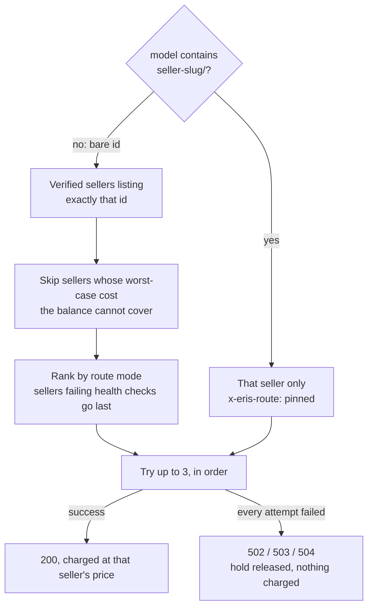

# Routing

How ERIS chooses the seller that serves a request.

## Pinned or across sellers

- **Pinned:** `seller-slug/model-id` goes only to that seller. The response says `x-eris-route: pinned`.
- **Across sellers:** a bare model id, such as `mistralai/mistral-nemo`, goes to every **verified** seller that lists exactly that id, best first by your route mode.

House listings (ERIS Starter, and the OpenRouter models ERIS verified itself) are verified. An independent seller becomes verified after review by ERIS. Until then it is marked *unverified* on the [Marketplace](https://erislabs.org/marketplace) and in `eris.verified`, and it is reached only when you name it with `seller-slug/model-id`.

## Route modes

| Mode | Ranks sellers by |
|---|---|
| `balanced` (default) | Price and latency, weighed equally after scaling each to the candidates' range. |
| `price` | Lowest average of input and output price; latency breaks ties. |
| `latency` | Lowest median latency of the seller's last 50 successful calls, increased by its failure rate over its last 20 calls. |

Choose with `"route": "price"` in the body, or an `x-eris-route: price` header. ERIS never forwards `route` to the seller.

## Failover

- ERIS tries at most three sellers. Sellers that failed their last health check, or their last three calls, are tried last.
- It moves on to the next seller when an endpoint cannot be reached, times out, returns a server error (5xx), is rate limited (429), returns 408, 409 or 425, or rejects ERIS's own credentials (401, 402, 403). Those describe the seller, not your request.
- Any other 4xx, such as a malformed request, comes straight back to you: another seller would refuse it too.
- A failed attempt costs nothing. If every seller fails, the hold is released in full.
